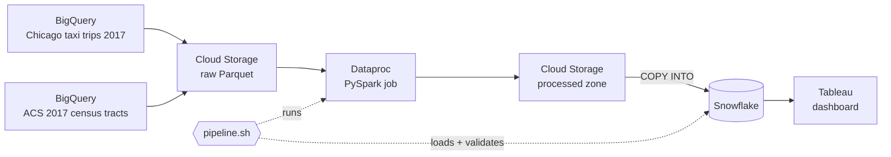

<div align="center">

# Chicago Taxi Demand Pipeline

**An end-to-end cloud data pipeline that joins 2017 Chicago taxi trips with U.S. Census neighborhood data,<br/>from raw public tables to a live Tableau dashboard, with one command.**


[](https://public.tableau.com/views/MSBA405FinalProjectDashboard/Dashboard1?:language=en-US&:display_count=n&:origin=viz_share_link)

</div>

## Highlights

| 📦 Raw data | ⚡ Processing | 🧾 Output | ▶️ Run |
| :---: | :---: | :---: | :---: |
| **~80 GB** | **PySpark on Dataproc** | **4,061 × 23** | **1 command** |
| Chicago Taxi Trips + ACS 2017 census tracts | clean, aggregate and join at scale | tract-month rows × features, loaded into Snowflake | `./pipeline.sh` runs Spark, the load and validation |

## The question

Which Chicago neighborhoods rely on taxis the most, and how does that demand relate to car ownership, transit use, walking, and income? To answer it, the pipeline turns millions of raw trip records into a clean monthly panel: one row per pickup census tract per month, enriched with the tract's demographics from the American Community Survey.

## Architecture



1. **Ingest.** The 2017 taxi trips and the ACS tract table are exported from BigQuery public datasets to Cloud Storage as Snappy-compressed Parquet.
2. **Clean.** A PySpark job on Dataproc drops invalid and implausible trips and standardizes census tract IDs (rules below).
3. **Engineer and aggregate.** Trips are rolled up to pickup tract × month, and eight ACS share features plus trips per capita and per household are derived.
4. **Load.** Spark writes Parquet plus one headered CSV, which Snowflake loads from an external stage with `COPY INTO`, aborting on any bad row.
5. **Validate.** The pipeline checks the row count and samples the table right after the load.
6. **Visualize.** Tableau reads the Snowflake table to map and compare demand across neighborhoods.

## Data quality rules

| Rule | Purpose |
| --- | --- |
| Trip in calendar year 2017, with both pickup and drop-off tract present | consistent one-year, tract-level panel |
| Duration > 0 and under 4 hours; distance > 0 and under 100 miles | remove meter errors and stuck trips |
| Fare and tips ≥ 0; total > 0, under $500 and ≥ fare | remove impossible or extreme charges |
| Implied speed between 1 and 80 mph | keep only physically plausible trips |
| Tip rate computed only when the fare is positive | null-safe division instead of dividing by zero |
| ACS rows limited to Cook County tracts (GEOID `17031…`) with positive population, household, commuter and worker counts | valid denominators for every share |
| Every derived share must fall within [0, 1] | reject inconsistent census records |

<details>
<summary><b>Output schema: 23 columns</b></summary>

| Group | Columns |
| --- | --- |
| Keys | `tract_id` (11-character GEOID), `month` |
| Taxi demand | `trip_count`, `trips_per_capita`, `trips_per_household`, `total_revenue` |
| Trip profile | `avg_trip_miles`, `avg_trip_minutes`, `avg_trip_total`, `avg_tip_rate` |
| Population | `total_pop`, `households`, `commuters_16_over` |
| Commuting and cars | `car_share`, `transit_share`, `walk_share`, `work_home_share`, `no_car_share` |
| Demographics and income | `children_share`, `in_school_share`, `bachelors_rate`, `median_income`, `income_per_capita` |

</details>

## Dashboard

**[MSBA405 Final Project Dashboard on Tableau Public](https://public.tableau.com/views/MSBA405FinalProjectDashboard/Dashboard1?:language=en-US&:display_count=n&:origin=viz_share_link)** brings the Snowflake table to life:

- a **heatmap of taxi trips per capita** across Chicago census tracts
- a **map of households without a car**
- scatter plots of taxi demand against **walk share**, **car share**, **no-car share** and **median income**

## Engineering highlights

- **One command, fail-fast.** `pipeline.sh` runs in strict mode (`set -euo pipefail`) and checks configuration, Google Cloud login, project, bucket, cluster state and the exact Spark output file before anything is loaded.
- **Safe to re-run.** Every stage overwrites its outputs and the Snowflake table is recreated, so a rerun never duplicates data.
- **One schema contract.** The 23-column order is defined once in the PySpark job (`FINAL_COLUMNS`) and tests check it against both SQL table definitions.
- **Secrets stay out of the code.** Credentials come only from environment variables; the Snowflake password never appears on the command line, in generated SQL or in a saved connection, and temporary SQL is deleted on exit.
- **Correct identifiers.** Census tract GEOIDs are stored as `VARCHAR(11)` so leading zeros survive, and ACS IDs in either plain or prefixed form are normalized to the same 11 digits.
- **Tests without the cloud.** `python tests/smoke_test.py` checks Bash syntax, the schema contract, broken documentation links and accidental credentials in seconds, with no cloud access needed.

## Run it yourself

### Prerequisites

- A Google Cloud project with BigQuery, Cloud Storage and a running Dataproc cluster
- A Snowflake account with a storage integration and an external stage on the bucket's `processed/` folder
- `gcloud` and Snowflake CLI (`snow`) installed and authenticated, plus Bash 4+ and Python 3

One-time setup guides: [data export](docs/data_setup.md) · [pipeline](docs/pipeline_setup.md) · [Snowflake](docs/snowflake_setup.md)

### Environment variables

```bash
export GCP_PROJECT_ID='YOUR_GCP_PROJECT_ID'
export GCS_BUCKET='YOUR_GCS_BUCKET_NAME'
export DATAPROC_CLUSTER='YOUR_DATAPROC_CLUSTER_NAME'
export DATAPROC_REGION='YOUR_DATAPROC_REGION'
export PYSPARK_FILE='dataproc/clean_and_aggregate_v3.py'

export SNOWFLAKE_ACCOUNT='YOUR_SNOWFLAKE_ACCOUNT'
export SNOWFLAKE_USER='YOUR_SNOWFLAKE_USERNAME'
export SNOWFLAKE_PASSWORD='YOUR_SNOWFLAKE_PASSWORD'
export SNOWFLAKE_ROLE='YOUR_SNOWFLAKE_ROLE'
export SNOWFLAKE_WAREHOUSE='YOUR_SNOWFLAKE_WAREHOUSE'
export SNOWFLAKE_DATABASE='YOUR_SNOWFLAKE_DATABASE'
export SNOWFLAKE_SCHEMA='YOUR_SNOWFLAKE_SCHEMA'
export SNOWFLAKE_TABLE='YOUR_SNOWFLAKE_TABLE'
export SNOWFLAKE_FILE_FORMAT='YOUR_SNOWFLAKE_FILE_FORMAT'
export SNOWFLAKE_STAGE='YOUR_SNOWFLAKE_STAGE'
```

Never commit real values or an environment file.

### Run

```bash
python tests/smoke_test.py   # offline checks, no cloud access needed
chmod +x pipeline.sh
./pipeline.sh                # Spark job → Snowflake load → validation queries
```

The script stops at the first failed check or cloud command. On success it prints the final Parquet path, the exact CSV file, and the Snowflake table, followed by the loaded row count and a ten-row sample.

<details>
<summary><b>Outputs written on every run</b></summary>

| Location | Contents |
| --- | --- |
| `gs://YOUR_GCS_BUCKET_NAME/processed/taxi_cleaned/` | cleaned trip-level Parquet |
| `gs://YOUR_GCS_BUCKET_NAME/processed/census_cleaned/` | cleaned tract-level Parquet |
| `gs://YOUR_GCS_BUCKET_NAME/processed/taxi_census_tract_month/` | final tract-month Parquet |
| `gs://YOUR_GCS_BUCKET_NAME/processed/final_dataset_single_csv/` | the same data as one headered CSV for Snowflake |
| `SNOWFLAKE_DATABASE.SNOWFLAKE_SCHEMA.SNOWFLAKE_TABLE` | the 23-column table, replaced on each run |

</details>

## Repository structure

```text
chicago-taxi-demand-data-pipeline/
├── pipeline.sh                      # one-command orchestrator: Dataproc → Snowflake → validation
├── dataproc/
│   └── clean_and_aggregate_v3.py    # PySpark job: cleaning, features, aggregation, join
├── snowflake/
│   └── load_final_dataset.sql       # reference SQL for the Snowflake load
├── tableau/                         # dashboard notes and link
├── docs/                            # one-time setup guides for data, pipeline and Snowflake
├── tests/
│   └── smoke_test.py                # offline repository checks
└── requirements.txt
```

## Data sources

- **Chicago Taxi Trips** from the City of Chicago (`bigquery-public-data.chicago_taxi_trips.taxi_trips`), filtered to trips that started in 2017
- **American Community Survey 2017 5-year estimates** at the census-tract level from the U.S. Census Bureau (`bigquery-public-data.census_bureau_acs.censustract_2017_5yr`)

---

<div align="center">
<sub>UCLA Anderson MSBA · MGMT 405 final project · <a href="https://github.com/charleswei2003">Zizhan (Charles) Wei</a> · <a href="https://www.linkedin.com/in/charles-z-wei">LinkedIn</a></sub>
</div>
